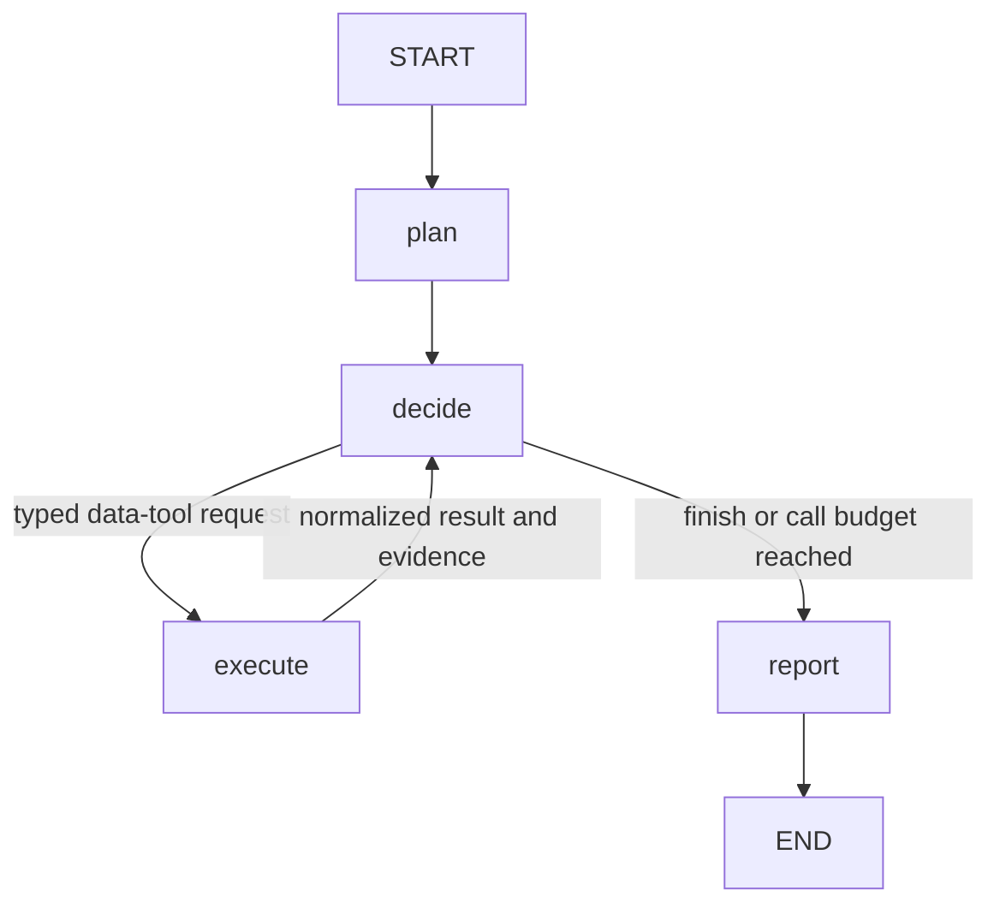

# Agentic Financial Research

Pass 1 of a platform that will combine market research with quantitative experiments.
This pass is a CLI, a LangGraph research loop, Pydantic state, and three typed fixture tools.

**Every price, macro value, and news item is synthetic.** The fixture period is
2025-01-02 to 2025-03-31. This application does not fetch current market data.

## Run the first pass

The project environment has already been installed in `.venv` in this workspace:

```sh
.venv/bin/financial-research
```

The default question is “Why has silver outperformed gold recently?” The default
`demo` mode replays scripted model decisions. It needs no credentials and supports
only this question, so it cannot silently apply the canned answer to an unrelated question.

Each run prints its decisions and creates a fresh `runs/<run-id>/` directory:

- `report.md`: findings, limitations, and collected sources.
- `state.json`: plan, actions, tool results, evidence, short decision rationales, and stop reason.

The normal demo makes three tool calls, collects five evidence items, and stops
because the scripted model selects `finish_research`.

Compare a run that stops earlier:

```sh
.venv/bin/financial-research --max-tool-calls 1
```

Only price evidence is collected. The stop reason becomes `tool_budget_exhausted`,
and the report acknowledges incomplete research. The bound counts attempted data
tool calls, including failed and repeated calls. It does not count LLM requests or tokens.

## How the loop works



The graph owns routing, tool execution, evidence IDs, and the call budget. The model
owns the research plan, next-action selection, and report content. Each decision
receives the updated state, so it can respond to the last tool result.

`DemoModel` is intentionally scripted; it teaches graph execution, not autonomous
research. In `llm` mode, the same graph uses native model function calls to choose
the next tool, its arguments, or an early stop. The tool catalog contains only
`get_market_prices`, `get_macro_series`, `search_news`, and the `finish_research` routing action.

## Read the code in this order

1. [`state.py`](src/financial_research/state.py): the research snapshot shared by nodes.
2. [`workflow.py`](src/financial_research/workflow.py): four small nodes and conditional routing.
3. [`models.py`](src/financial_research/models.py): typed actions, results, evidence, and report contracts.
4. [`tools.py`](src/financial_research/tools.py): fixture data, calculated returns, and explicit unavailable-data results.
5. [`research_model.py`](src/financial_research/research_model.py): the model interface and scripted demo.

Then work through [`docs/pass-1.md`](docs/pass-1.md). The optional provider adapter
and CLI plumbing can wait until you understand the graph.

## Optional: let an LLM choose the tools

Install the provider extra if needed, then configure credentials through your shell:

```sh
.venv/bin/python -m pip install -e '.[llm]'
# Set OPENAI_API_KEY securely in your environment.
export OPENAI_MODEL="gpt-6.1-sol"
.venv/bin/financial-research --mode llm
```

Select a model available to your API account that supports Responses function
calling and structured outputs. This is the application's API model; it is
configured independently of the model helping you write code in Codex.

LLM mode makes billable API requests. The tools still return synthetic fixtures.
Other questions are allowed in this mode, but the agent should acknowledge when
the fixture scope cannot answer them. No credentials or `.env` files are loaded or
copied into run artifacts by application code.

The adapter uses a fresh, bounded state snapshot per request, rather than retaining
an accumulating provider conversation. Normalized tool results are supplied in the
next snapshot. Plans and reports use structured outputs; next actions use native
function calling. Responses set `store=False`. SDK request timeouts are 30 seconds
with at most one SDK retry. Provider errors or invalid model outputs stop the run
with an error instead of fabricating a report.

Implementation references: [OpenAI function calling](https://developers.openai.com/api/docs/guides/function-calling),
[structured outputs](https://developers.openai.com/api/docs/guides/structured-outputs),
and the [LangGraph graph API](https://docs.langchain.com/oss/python/langgraph/graph-api).

## Install and test

Python 3.11 or later; this pass was tested with Python 3.14.3.

```sh
python3 -m venv .venv
.venv/bin/python -m pip install -c requirements.lock -e '.[dev,llm]'
.venv/bin/python -m pytest
```

For an offline-demo installation, use `'.[dev]'` instead. Runtime dependencies are
LangGraph for stateful orchestration and Pydantic for boundary validation. Pytest
is a development dependency; the OpenAI SDK is an optional provider dependency.
`requirements.lock` records the exact tested dependency versions, including the optional extras.

Tests cover routing, failed tools, budget enforcement, evidence deduplication,
citation integrity, invalid requests, CLI artifacts, and SDK serialization/parsing
through an in-memory HTTP transport. They make no live model requests. A live
model smoke test and quality evaluation remain outstanding.

## Boundaries of this pass

The citation check rejects unknown evidence IDs, and every report claim must have
at least one citation. It does **not** verify that the cited evidence supports the
claim. Uncited factual assertions in report titles or limitations are constrained
by prompts, not semantic validation. Groundedness evaluation belongs in a later pass.

There is no critic/revision loop, real data integration, checkpoint/resume support,
tracing setup, or quant workflow yet. The event list is a small execution log, not
an observability platform. Failed model runs print an error; only successful runs
save artifacts. The next pass replaces one fixture tool with a real adapter while
preserving the graph and normalized evidence boundary.

Later quantitative tools can produce evidence with additional experiment metadata.
They will use a separate experiment workflow, rather than squeezing methodology
and validation into this first research loop.
