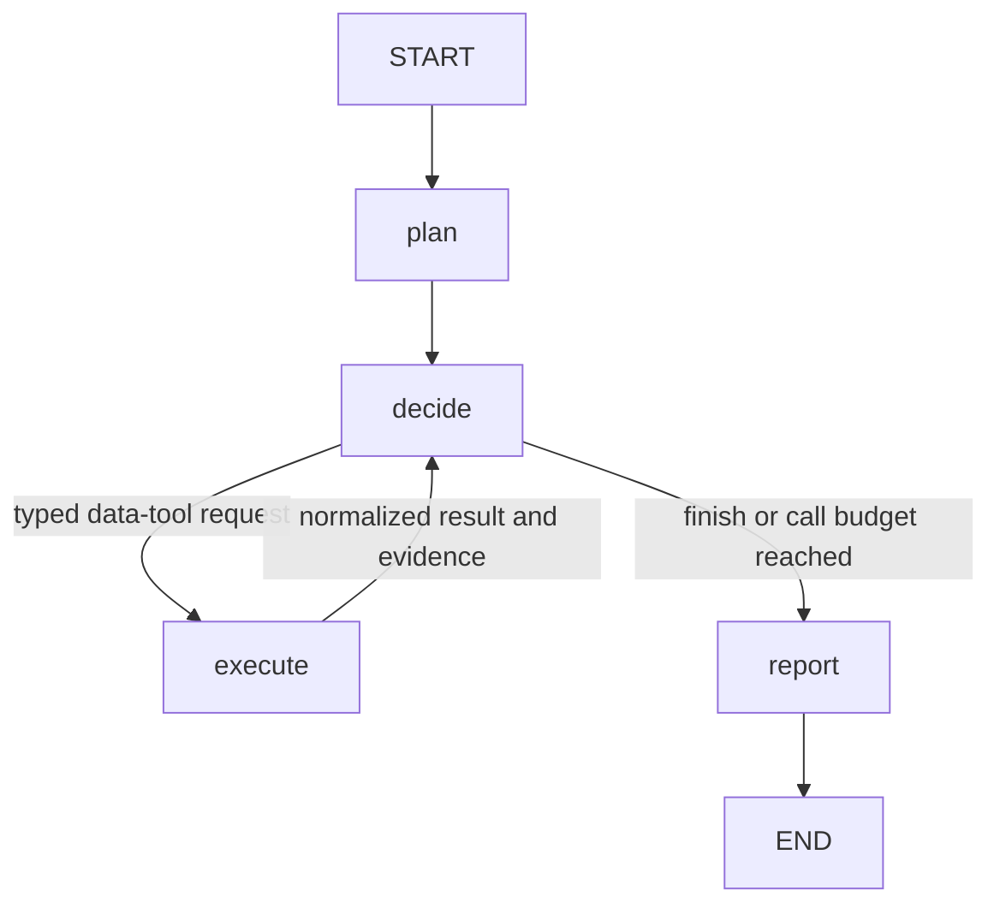

# Agentic Financial Research

An incremental platform combining market research with future quantitative experiments.
The research agent has a CLI, a LangGraph loop, Pydantic state, and three fixture tools.
Real prices and macro data are available independently and through the graph in pass 2.

**Local Ollama and real data are the defaults.** Provide a question, symbols, and
dates; Yahoo supplies prices and FRED supplies macro data when requested. Use
`--mode demo` for the offline synthetic example. Real news integration is still pending.

## Run the first pass

The project environment has already been installed in `.venv` in this workspace:

```sh
.venv/bin/financial-research --mode demo
```

The demo question is “Why has silver outperformed gold recently?” Explicit
`demo` mode replays scripted model decisions over synthetic data for
2025-01-02 to 2025-03-31. It needs no credentials and supports
only this question, so it cannot silently apply the canned answer to an unrelated question.

Each run prints its decisions and creates a fresh `runs/<run-id>/` directory:

- `report.md`: findings, limitations, and collected sources.
- `state.json`: plan, actions, tool results, evidence, short decision rationales, and stop reason.

The normal demo makes three tool calls, collects five evidence items, and stops
because the scripted model selects `finish_research`.

Compare a run that stops earlier:

```sh
.venv/bin/financial-research --mode demo --max-tool-calls 1
```

Only price evidence is collected. The stop reason becomes `tool_budget_exhausted`,
and the report acknowledges incomplete research. The bound counts attempted data
tool calls, including failed and repeated calls. It does not count LLM requests or tokens.

## How the loop works



The graph owns routing, tool execution, evidence IDs, and the call budget. The model
owns the research plan, next-action selection, and report content. Each decision
receives the updated state, so it can respond to the last tool result.

`DemoModel` is intentionally scripted; it teaches graph execution, not autonomous
research. In `ollama` and `llm` modes, the same graph uses native model function calls to choose
the next tool, its arguments, or an early stop. Fixture mode offers
`get_market_prices`, `get_macro_series`, `search_news`, and `finish_research`.
Real-data mode offers `get_market_prices`, `get_macro_series`, and `finish_research`.
It excludes fixture news and never falls back to synthetic observations.

## Read the code in this order

1. [`state.py`](src/financial_research/state.py): the research snapshot shared by nodes.
2. [`workflow.py`](src/financial_research/workflow.py): four small nodes and conditional routing.
3. [`models.py`](src/financial_research/models.py): typed actions, results, evidence, and report contracts.
4. [`tools.py`](src/financial_research/tools.py): fixture data, calculated returns, and explicit unavailable-data results.
5. [`research_model.py`](src/financial_research/research_model.py): the model interface and scripted demo.

## Use local Qwen with Ollama

With Ollama running and `qwen2.5:7b` installed:

```sh
.venv/bin/python -m financial_research \
  "How did AAPL closing prices change during 2024?" \
  --symbols AAPL --start-date 2024-01-01 --end-date 2024-12-31
```

This calls your local server at `http://127.0.0.1:11434/api/chat`. No OpenAI credits
or additional Python dependencies are needed. Yahoo prices need no API key; FRED
macro requests require `FRED_API_KEY`, as described below. Qwen chooses the plan,
tool calls, and report over real data. `--mode ollama` is optional because it is
the default.

Use `ollama list` to see installed models. Select a different installed model with
`--model`, or set `OLLAMA_MODEL`. The default is `qwen2.5:7b`; `OPENAI_MODEL` has no
effect on local mode. If the server is stopped, start Ollama or run `ollama serve`.

[`ollama_model.py`](src/financial_research/ollama_model.py) implements the existing
`ResearchModel` interface. Plans and reports use JSON schemas; next actions use
native tool calling. Python validates both before the graph uses them. Requests
have a 120-second timeout and bounded context/output settings; invalid or
truncated responses stop the run explicitly. Local model quality can vary, so a
successful run establishes integration rather than research completeness.

The shared instructions and tool catalog live in `research_model.py`, so both
provider adapters receive the same scope and available actions.

References: [Ollama tool calling](https://docs.ollama.com/capabilities/tool-calling)
and [structured outputs](https://docs.ollama.com/capabilities/structured-outputs).

## Research real prices and macro data with Qwen

To research several years of prices with local Qwen:

```sh
.venv/bin/python -m financial_research \
  "How did AAPL and MSFT closing prices change from 2020 through 2024?" \
  --symbols AAPL MSFT --start-date 2020-01-01 --end-date 2024-12-31
```

No price API key is required. Real-data mode requires an explicit question,
symbols, and dates, and cannot use the scripted `demo` model.
Running without arguments prints the required scope and points to `--mode demo`.

The model can select from the permitted symbols and decide when to fetch or stop.
Python enforces the configured symbol set and date range before calling the real
tool. It records failures without falling back to fixtures. Reports identify
the configured real-data tools and the evidence actually retrieved.

Both real-data tools are available to the model; macro calls reuse the configured
date range. The former `--data-source` option has been removed. Model-backed runs
use real data, and `--mode demo` uses synthetic fixtures.

The configured scope is stored in `state.json` as `price_request`, alongside full
selected daily series. Model requests contain price summaries and provenance;
daily rows are omitted from model context to avoid repeatedly filling its context
window with the same price history. This does not alter the saved evidence.

## Fetch real macro data

[`macro.py`](src/financial_research/macro.py) implements
`get_macro_series(HistoricalMacroRequest) -> ToolResult`. It retrieves FRED series
metadata and historical values. The series ID is parameterized: `DFII10` (10-year
real Treasury yield) is the initial example, not a whitelist.

Set `FRED_API_KEY` in your environment using a
[registered FRED API key](https://fred.stlouisfed.org/docs/api/api_key.html).
The application does not load `.env` files. Run the tool independently:

```sh
.venv/bin/python -m financial_research.macro \
  --series-id DFII10 --start-date 2020-01-01 --end-date 2024-12-31
```

Or ask Qwen to collect both prices and macro data:

```sh
.venv/bin/python -m financial_research \
  "Compare AAPL price changes and DFII10 real-yield changes from 2020 through 2024, without causal claims." \
  --symbols AAPL --start-date 2020-01-01 --end-date 2024-12-31
```

- Values retain the provider's units, frequency, and seasonal adjustment. A
  difference in a `Percent` series is reported in **percentage points**, not as a
  percent return. Other series use differences in their native units.
- Missing FRED values (`.`) are saved as null, excluded from endpoint calculations,
  and counted. No values are filled or resampled; at least two numeric observations
  are required. Actual dates and shorter coverage are reported.
- Full values are saved in `state.json`; model context contains summaries only.
  The API key is excluded from observations, provenance URLs, and error messages.
- FRED's latest available vintage and provider update time are recorded. Historical
  values can include revisions; this is not an as-of dataset for backtesting.
- The tool requests up to FRED's 100,000-observation maximum and rejects incomplete
  responses rather than silently truncating. Each call requests metadata and values.
  Missing credentials and provider failures become tool errors; Yahoo price-only
  requests still work without a FRED key.

A live 2020–2024 DFII10 check retrieved 1,251 numeric values and 54 missing values.
Automated tests cover the adapter and the full CLI/model/tool/evidence/report path
using mocked provider responses.

Source contracts: [FRED series metadata](https://fred.stlouisfed.org/docs/api/fred/series.html)
and [historical observations](https://fred.stlouisfed.org/docs/api/fred/series_observations.html).

## Fetch real prices independently

[`prices.py`](src/financial_research/prices.py) implements
`get_market_prices(HistoricalPriceRequest) -> ToolResult`. The dated request in
`models.py` accepts 1–5 Yahoo Finance symbols, a rationale, and inclusive start/end
dates. Symbols are trimmed, uppercased, and deduplicated. Examples include `AAPL`,
`MSFT`, and `SPY`; availability and instrument meanings follow Yahoo's symbols.

Yahoo Finance is accessed through `yfinance`. No API key is required:

```sh
.venv/bin/python -m financial_research.prices \
  --symbols AAPL MSFT \
  --start-date 2020-01-01 --end-date 2024-12-31
```

The command prints our normalized `Observation`/`ToolResult` JSON: selected daily
closes, close-price change, requested and actual dates, provider currency/unit and
timezone when available, retrieval timestamp, and source URL. Observations are
marked as real data. `yfinance` is a runtime dependency; its DataFrame output is
converted to ordinary validated Python values at this boundary.

Data boundaries:

- Daily history supports multi-year requests, with coverage depending on the
  symbol. This tool has no 100-observation cap. It does not fetch intraday data.
- Dates select observed closes within the inclusive interval. Yahoo's exclusive
  end date is translated internally. At least two closes are required. No missing
  sessions are filled; shorter coverage is explicitly noted alongside actual dates.
- Changes use Yahoo's `Close` column with `auto_adjust=False`: no additional
  dividend adjustment is applied by the client. These are price changes, not total
  returns. Currency/unit is preserved as reported (for example `GBp`); missing
  currency stays unknown.
- Each distinct symbol gets a history request. `yfinance` manages the underlying
  Yahoo session and may make several HTTP requests. The tool adds no retries.
  A failure for any symbol returns an error with no partial observations and a
  nonzero CLI exit status; there is no fallback to synthetic data.
- `yfinance` is an unofficial client intended for personal research. Yahoo can
  rate-limit requests or change its endpoints; it is not a guaranteed data service.

Tests use mocked provider DataFrames to check multi-year history, inclusive dates,
normalization, calculations, coverage, and failures without network access.
A separate live check fetched 1,258 daily closes for each of AAPL and MSFT from
2020-01-02 through 2024-12-31 without an API key.

Source contract: [yfinance documentation](https://ranaroussi.github.io/yfinance/)
and [history date/adjustment options](https://ranaroussi.github.io/yfinance/reference/api/yfinance.download.html).

## Optional: use the OpenAI provider

Install the provider extra if needed, then configure credentials through your shell:

```sh
.venv/bin/python -m pip install -e '.[llm]'
# Set OPENAI_API_KEY securely in your environment.
export OPENAI_MODEL="gpt-6.1-sol"
.venv/bin/financial-research \
  "How did AAPL closing prices change during 2024?" --mode llm \
  --symbols AAPL --start-date 2024-01-01 --end-date 2024-12-31
```

Select a model available to your API account that supports Responses function
calling and structured outputs. This is the application's API model; it is
configured independently of the model helping you write code in Codex.

LLM mode makes billable API requests and uses the same real-data tools and
required scope as local Ollama mode. No credentials or `.env` files are loaded or
copied into run artifacts by application code.

The adapter uses a fresh, bounded state snapshot per request, rather than retaining
an accumulating provider conversation. Normalized tool results are supplied in the
next snapshot. Plans and reports use structured outputs; next actions use native
function calling. Responses set `store=False`. SDK request timeouts are 30 seconds
with at most one SDK retry. Provider errors or invalid model outputs stop the run
with an error instead of fabricating a report.

Implementation references: [OpenAI function calling](https://developers.openai.com/api/docs/guides/function-calling),
[structured outputs](https://developers.openai.com/api/docs/guides/structured-outputs),
and the [LangGraph graph API](https://docs.langchain.com/oss/python/langgraph/graph-api).

## Install and test

Python 3.11 or later; this pass was tested with Python 3.14.3.

```sh
python3 -m venv .venv
.venv/bin/python -m pip install -c requirements.lock -e '.[dev,llm]'
.venv/bin/python -m pytest
```

For an offline-demo installation, use `'.[dev]'` instead. Runtime dependencies are
LangGraph for orchestration, Pydantic for validation, and yfinance for real prices. Pytest
is a development dependency; the OpenAI SDK is an optional provider dependency.
`requirements.lock` records the exact tested dependency versions, including the optional extras.

Tests cover routing, failed tools, budget enforcement, evidence deduplication,
citation integrity, invalid requests, CLI artifacts, and both provider adapters
through mocked HTTP transports. Real-price tests exercise the full CLI/model/tool/
evidence/report path, enforce scope and fixture isolation, and check that context
summaries preserve full saved data. The automated tests make no live model requests.
Separate local smoke tests verified both fixture research and Qwen fetching real
AAPL/MSFT prices for 2020–2024 through Yahoo Finance, then writing a cited report. OpenAI live verification
and research-quality evaluation remain outstanding. An earlier fixture report
omitted collected counterevidence, illustrating a quality issue for the later
evaluation/critic pass.

## Boundaries of this pass

The citation check rejects unknown evidence IDs, and every report claim must have
at least one citation. It does **not** verify that the cited evidence supports the
claim. Uncited factual assertions in report titles or limitations are constrained
by prompts, not semantic validation. Groundedness evaluation belongs in a later pass.

There is no critic/revision loop, checkpoint/resume support, tracing setup, or
quant workflow yet. The event list is a small execution log, not an observability
platform. Failed model runs print an error; only successful runs save artifacts.
Real prices and macro data are connected; real news is the next checkpoint within
pass 2. Endpoint comparisons can establish what changed, but cannot establish
the cause of a market move. Model context does not include the full time series,
so deeper statistical analysis needs a separate quantitative tool.

Later quantitative tools can produce evidence with additional experiment metadata.
They will use a separate experiment workflow, rather than squeezing methodology
and validation into this first research loop.
