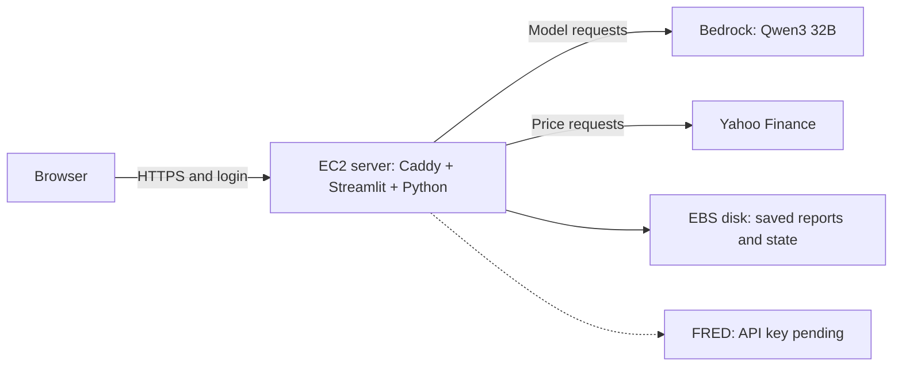

# Deploy the Streamlit app

This deployment runs Streamlit on one EC2 server in Stockholm (`eu-north-1`).
Visitors use an HTTPS address and a shared app login. The server calls Bedrock
using its instance role; visitors need neither AWS credentials nor Ollama.



Hosted-preview follow-up: add the FRED API key to the runtime SecureString and
verify a real macro request. Price research already works without it.

Bedrock serves the existing Qwen model on demand; there is no dedicated model
instance in this stack. The server's IAM role authorizes its model requests.
Our Python [`ResearchState`](../src/financial_research/state.py) holds the run's
question, plan, evidence, and tool results. Each
[`BedrockModel` request](../src/financial_research/bedrock_model.py) sends the
current `model_context()` summary; conversation context is supplied by our app.

Review the files in this order:

1. [`../Dockerfile`](../Dockerfile): the Python app image, running as a non-root user.
2. [`Caddyfile`](Caddyfile): HTTPS, password authentication, and forwarding to Streamlit.
3. [`stack.yaml`](stack.yaml): network, server, instance permissions, and private release storage.
4. [`deploy.py`](deploy.py): package a committed release, configure settings, and send it to the server.
5. [`host.sh`](host.sh): build and health-check a candidate, then replace the running containers.

The app, CLI, research graph, and saved-run format stay shared. `RESEARCH_HOSTED=1`
defaults the UI to Bedrock and hides the local Ollama option. A build argument
records the release's Git revision in `run.json`, without putting `.git` in the image.

## Cost and scope

Approximate monthly cost at 730 hours, before tax, credits, backups, and excess transfer:

| Component | Configuration | USD/month |
| --- | --- | ---: |
| EC2 | `t4g.small`, 2 GB RAM, Arm64, $0.0172/hour | $12.56 |
| Encrypted gp3 disk | 20 GB at $0.0836/GB-month | $1.67 |
| Public IPv4 | One address at $0.005/hour | $3.65 |
| **Server subtotal** | | **$17.88** |
| Bedrock, illustrative | 300–600 runs, each 20k input + 5k output tokens | $1.80–$3.60 |

The Bedrock illustration uses Qwen3 32B rates of $0.15/million input tokens and
$0.60/million output tokens. Actual usage varies with tools, evidence, and review.
Small S3/Parameter Store usage is additional. Recheck [EC2](https://aws.amazon.com/ec2/pricing/on-demand/),
[EBS](https://aws.amazon.com/ebs/pricing/), [public IPv4](https://aws.amazon.com/vpc/pricing/),
and [Bedrock pricing](https://aws.amazon.com/bedrock/pricing/) before launching.
Credits can offset the bill temporarily; they do not change these underlying rates.

There is no load balancer, NAT gateway, database, or hosted GPU. Standard CPU credits
avoid surplus CPU charges, but can slow a sustained build or busy server. This is a
single-server deployment with brief interruptions during releases, not high availability.
Stopping the instance still leaves disk and public IPv4 charges.

## Before the first launch

Review the infrastructure and costs before launching. Deploy from a committed
checkout; a PR branch can be tested before merging. If your review changes are
unstaged, save them locally and switch to the committed branch first.

1. In **AWS Settings → View all projects → FinancialResearch → Overview → Additional Info**,
   confirm the selected Region is `eu-north-1`. Check **AWS Settings → Billing** for
   plan status, remaining credits, and any spend limit. The script checks plan status
   but does not change the plan or set a spending cap.
2. Reserve a free hostname at [DuckDNS](https://www.duckdns.org/), for example
   `your-chosen-name.duckdns.org`. No DuckDNS token is needed by this application.
3. Install the local deployment dependencies and refresh your AWS login:

   ```bash
   .venv/bin/python -m pip install -e '.[deploy]'
   aws login --profile financial-research
   ```

4. From a clean, committed checkout, run:

   ```bash
   .venv/bin/python deployment/deploy.py --domain your-chosen-name.duckdns.org
   ```

The default profile and stack name are `financial-research`; the only permitted
Region is `eu-north-1`. The script prompts for a shared username/password and an
optional FRED key. It hashes the password locally with bcrypt, then stores the hash
and optional key in an SSM **SecureString**. Do not paste credentials into GitHub,
the template, or command-line arguments. Without a FRED key, price research and the
offline demo remain available; macro requests report that configuration is missing.

Once the script prints the server's IP address, enter it in DuckDNS and save.
Caddy obtains and renews the certificate once DNS points to the server; ports 80
and 443 must remain reachable. [Caddy's HTTPS documentation](https://caddyserver.com/docs/automatic-https)
explains this process. DNS propagation and certificate issuance can take a few minutes.
The script checks the internal app, not public DNS or certificate issuance.

After the release finishes:

1. Open `https://your-chosen-name.duckdns.org`. Confirm it asks for a login and rejects a wrong password.
2. Run the **Offline demo** and download the report, state, and diagnostics.
3. Select **Amazon Bedrock**, run one short AAPL question with two tool calls and
   review disabled, and inspect its evidence, report, and model usage.

Share the app login only with intended visitors. Authenticated visitors can trigger
paid inference; the tool-call budget bounds one run, not aggregate monthly spend.

## What the release does

`stack.yaml` is an AWS CloudFormation template written in YAML. YAML is the file
format; CloudFormation is the AWS service that creates and updates the resources
declared in it as a group called a stack. This project uses CloudFormation for its
infrastructure rather than Terraform. The template defines the server, networking,
permissions, and release bucket; runtime secrets are configured separately.

Once that infrastructure exists, the application needs to be installed on EC2.
`deploy.py` packages committed Python source, Dockerfile, dependencies, and config
into a `.tar.gz` archive. Personal notes, `.aws`, `.git`, and `runs` are excluded.
S3 holds these release archives; saved research reports remain on the EC2 disk.

Systems Manager runs commands on EC2: download the archive from S3, verify its
SHA-256, extract it, and execute `host.sh`. That script builds the app image and
starts the app and Caddy containers. The private bucket lets EC2 retrieve a release
using its IAM role, without storing GitHub credentials on the server.

The instance role has the standard `AmazonSSMManagedInstanceCore` administration
permissions, plus access to the release prefix, runtime settings, and the selected
Qwen foundation model. The SSM managed policy includes broader Parameter Store
reads; the additional runtime policy scopes this app's settings and decrypt operation.
The Bedrock action was derived using IAM Policy Autopilot, then narrowed to
`bedrock:InvokeModel` for the model actually used. No guardrails, bearer-token
invocation, or built-in server tools are requested by this adapter.

The security group exposes only HTTP/HTTPS. Streamlit's port 8501 is internal;
SSH is closed. IMDSv2 supplies short-lived server credentials, including through
the container network. No personal AWS login cache is copied into the image.

The host keeps settings in root-readable files and run artifacts in
`/var/lib/financial-research/runs`. The app container has a read-only filesystem
except for run storage and temporary caches. Caddy's certificates persist separately.
The candidate must pass Streamlit's health check before replacing the app. This
check verifies startup; it does not prove that Bedrock or data providers are reachable.

## Updates, troubleshooting, and recovery

After merging a change, repeat the same deployment command from the new commit.
Updates preserve the original AMI, so a routine app release does not replace the
server. Operating-system/AMI upgrades need a separate reviewed maintenance change.
Use `--configure` when intentionally replacing the shared login or FRED settings.

If a release fails, the script exits unsuccessfully and prints its SSM command ID.
Inspect the result without SSH:

```bash
aws ssm get-command-invocation --profile financial-research --region eu-north-1 \
  --command-id COMMAND_ID --instance-id INSTANCE_ID
aws ssm start-session --profile financial-research --region eu-north-1 \
  --target INSTANCE_ID
```

Interactive sessions need the [Session Manager plugin](https://docs.aws.amazon.com/systems-manager/latest/userguide/session-manager-working-with-install-plugin.html).
On the server, inspect `docker logs financial-research-app`,
`docker logs financial-research-proxy`, and `/var/log/cloud-init-output.log`.
Settings must not be included in diagnostic output shared with others.

A candidate build/health failure leaves the previous app running. Later failures
during container replacement require operator recovery. The previous source release
path is saved in `/var/lib/financial-research/previous-release`; run its `host.sh`
through SSM with the same parameter name, hostname, and original Git revision to
rebuild it. This is a manual rollback, not automatic deployment recovery.

Run files survive container updates and reboots. They are local files, not an
off-server backup or LangGraph resume checkpoints. Back up important runs before
replacing the instance. A replacement does **not** automatically mount the old disk.

Deleting the stack leaves the S3 bucket and root disk retained, to avoid silently
deleting research. These continue to incur storage charges. The runtime SSM
parameter is also outside the stack. Before cleanup, decide which runs/releases to
keep, copy them somewhere safe, then explicitly remove the retained resources if
they are no longer needed. On a long-lived server, remove obsolete Docker build
caches/images after checking which current and previous releases you want to keep.

## Verification

The normal pytest suite tests packaging, password hashing, failed-release reporting,
AMI preservation, and the hosted UI without calling AWS. CI also runs pinned
`cfn-lint` and Guard checks, builds the image, checks its health endpoint, and runs
an offline research command inside it. `security.guard` contains four project rules;
it is not a comprehensive compliance assessment.

Local ARM64 checks also verified HTTPS using Caddy's localhost certificate, missing
and wrong passwords returning 401, an authenticated Streamlit WebSocket handshake,
and saved demo files surviving a container restart. AWS's read-only `ValidateTemplate`
accepted the template; this does not verify provisioning permissions or live connectivity.

The live preview was verified on 2026-11-08: public HTTPS and password protection,
authenticated WebSocket access, offline research, a real Bedrock/Yahoo research
run through the EC2 role, and run artifacts on the host's persistent storage.
The first launch exposed restrictive source permissions; the Dockerfile now makes
the source/config readable by the app user, and CI reproduces those permissions.
The complete `deploy.py` command still needs an end-to-end verification; the live
checks used individual AWS operations and temporary verification scripts.
